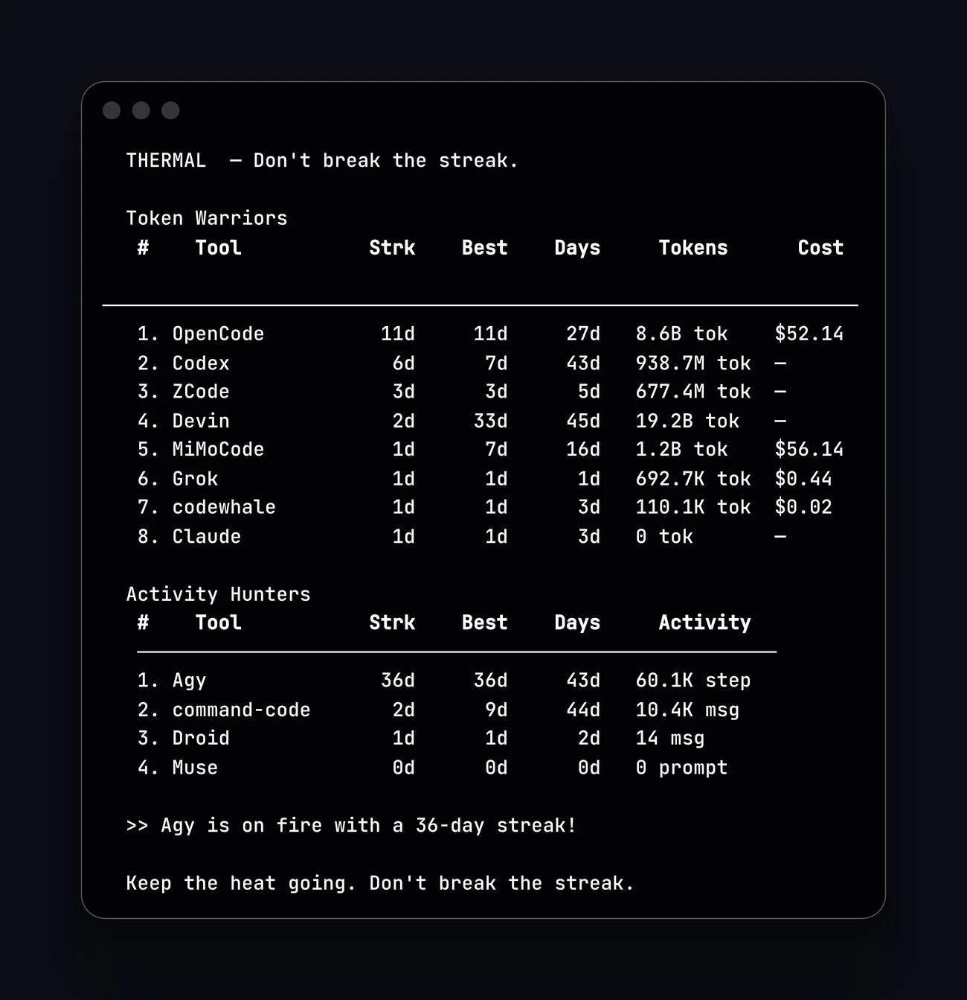
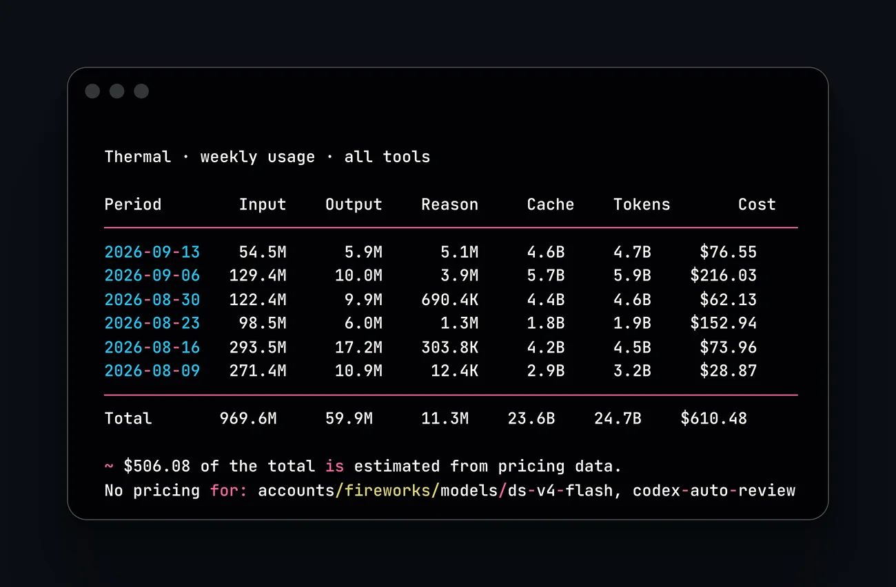
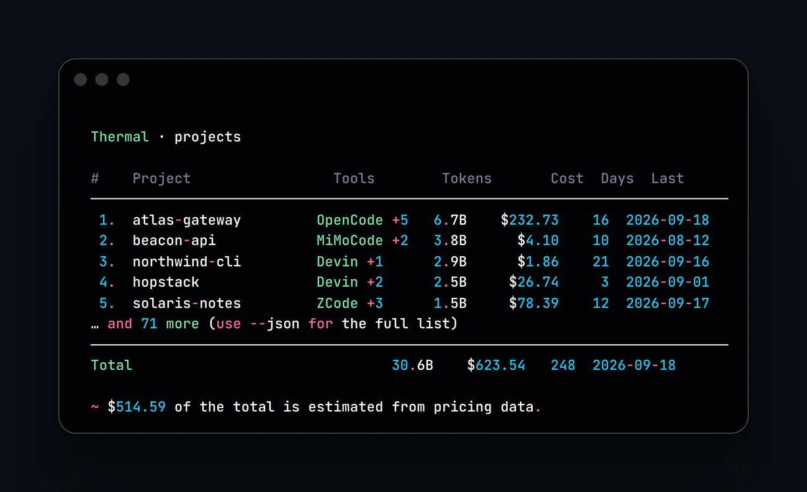
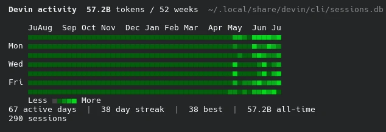
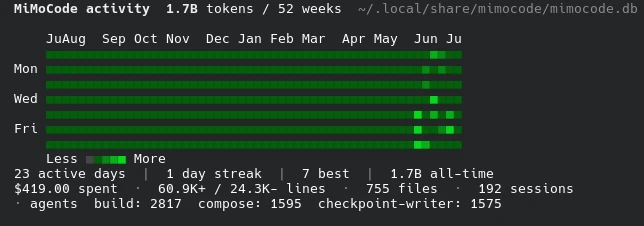
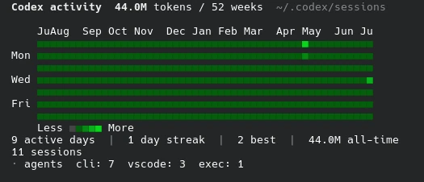
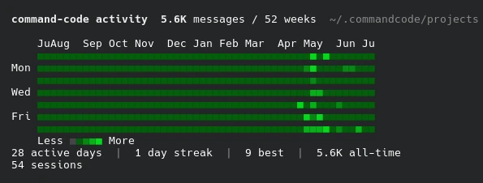
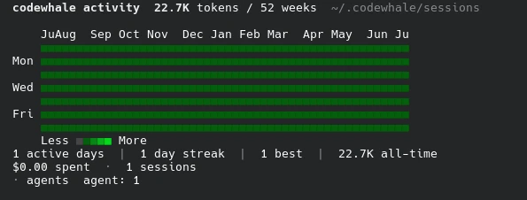

<p align="center">
  
</p>

# Thermal

[](https://goreportcard.com/report/github.com/jadmadi/thermal)
[](https://pkg.go.dev/github.com/jadmadi/thermal)
[](https://github.com/jadmadi/thermal/actions/workflows/ci.yml)
[](https://www.gnu.org/licenses/agpl-3.0)
[](DUAL-LICENSE.md)
[](GOVERNANCE.md)
[](https://slsa.dev)

> Multi-agent terminal heatmap, token FinOps, and live burn monitor for 15 AI coding agents.

```bash
# Automated install (Linux & macOS)
curl -fsSL https://jadmadi.net/thermal/install.sh | sh

# Homebrew (macOS & Linux)
brew install jadmadi/tap/thermal

# Go toolchain
go install github.com/jadmadi/thermal/cmd/thermal@latest
```

Unlike `git log`, which only shows committed code, Thermal shows what your agents actually burned: tokens, cost, and streaks across tools, even when nothing got committed. All local, zero cloud telemetry, and sub-10ms cached execution on the baseline fixture — see [docs/PERFORMANCE.md](docs/PERFORMANCE.md) for the measured limits at directory-scan scale.



*Illustrative capture from an earlier build; CMD now reports tokens and ranks in Token Warriors. Rows depend on the tools installed.*

## Why Thermal

**Thermal is the local-first answer to what your AI coding agents cost and what they produced — across 15 tools, with zero uploads and zero writes to your data.**

**Situation.** Developers run several agents in parallel, and each writes tokens, models, and spend to disk in its own SQLite, JSONL, or JSON format.

**Complication.** The numbers do not add up: spend and output are fragmented per tool, and nothing shows what an agent burned when the work was never committed.

**Question.** How do I see all of it in one place, safely?

**Answer.** Thermal scans every source read-only, unifies the math, prices what it can, and renders it in your terminal.

**The supporting argument, top to bottom:**

1. **Coverage — one model of the data.** Fifteen agents are ingested through three shapes — SQLite (`?mode=ro`, memory-mapped), JSONL transcripts, and JSON session files — behind one registry in `internal/loaders`. Model ids are canonicalized before they become keys, token types are disjoint, and subdirectories fold into their nearest git root, so one project merges across every tool that touched it.
2. **Trust — local, read-only, honest about limits.** Zero telemetry, no account, no daemon, and strictly read-only ingestion are codified anti-goals in [`GOVERNANCE.md`](GOVERNANCE.md). The daily update check is opt-out and `--offline` keeps pricing on disk. Recorded cost wins over an estimate, estimates carry a `~`, and models the catalog cannot price are named in the `No pricing for` line rather than treated as free.
3. **Insight — answers counting cannot.** `stats`, `mix`, and `trend` add distribution analytics, share drift, and regression forecasts.
4. **Speed — fast, and in every surface.** Sub-10ms cached invocation is an architectural invariant, kept by disk-backed delta snapshots, bounded worker pools, and a single static CGO-free binary. CLI reports, the live monitor (`thermal live`), and NDJSON streaming (`thermal live --json --stream`) render the same numbers, and tests assert that live totals agree with the static commands.

**The evidence:** a strict layered dependency rule (`loaders → thermal → pricing → render`), the [promise ledger](docs/PROMISES.md) with reproducible evidence and stated limits, [measured performance](docs/PERFORMANCE.md), SLSA Build Level 3 provenance, and a single-command pre-flight suite (`./scripts/check.sh`) gating every change.

**The price:** the CLI is free under AGPL-3.0. The **Commercial Use License is $30 per developer per year** for internal commercial use; embedding, hosted services, and support commitments are separate [Enterprise & OEM terms](DUAL-LICENSE.md). [Buy the $30 license](https://paypal.me/Madise/30) or read the [terms](COMMERCIAL-LICENSE.md).

## Pricing

| Edition | Price | Scope |
| --- | --- | --- |
| **Community** | **Free** (AGPL-3.0) | Personal, academic, and open-source use; full CLI and live monitor |
| **Commercial Use** | **$30 / developer / year** | Internal commercial use by named developers; updates; community support. No redistribution, embedding, hosted service, or SLA |
| **Enterprise & OEM** | **Contact** | Proprietary embedding, closed-source hosted services, fleet/security review, custom loaders, and support commitments |

[Live pricing page](https://thermal.jadmadi.net/pricing.html) · [Buy the $30 Commercial Use License](https://paypal.me/Madise/30) · [Commercial license terms](COMMERCIAL-LICENSE.md) · [Enterprise & OEM](mailto:contact@jadmadi.net?subject=Thermal%20Enterprise%20%26%20OEM)

## Supported Tools

| Tool               | Data Source                                        | Metrics                                       |
|--------------------|----------------------------------------------------|-----------------------------------------------|
| **Devin**          | SQLite DB (sessions + message_nodes)               | Token usage, sessions, cost                   |
| **OpenCode**       | SQLite DB (v1 and v2 storage)                      | Token usage, sessions, cost                   |
| **MiMoCode**       | SQLite DB                                          | Token usage, sessions, cost                   |
| **Codex**          | SQLite DB (state_5.sqlite) + rollout JSONL         | Token usage, sessions, model/source breakdown |
| **codewhale**      | JSON sessions                                      | Token usage, sessions, cost                   |
| **ZCode**          | SQLite DB (`model_usage` telemetry)                | Token usage, sessions, model/agent breakdown  |
| **Grok**           | JSONL session logs (`turn_completed` usage)        | Token usage, sessions, cost, model breakdown  |
| **Muse**           | SQLite session index                               | Prompt activity, sessions, model breakdown    |
| **Claude**         | JSONL session transcripts                          | Token usage, sessions, model breakdown        |
| **Droid**          | JSONL session transcripts                          | Message activity, sessions                    |
| **DeepSeek (DSH)** | JSON session cache (`~/.dsh/storages`)             | Token usage, sessions, model breakdown        |
| **Nous Hermes**    | SQLite DB (`~/.hermes/state.db`)                   | Token usage, sessions, cost, model breakdown  |
| **Zed**            | SQLite DB (`~/.local/share/zed/threads/threads.db`)| Token usage, sessions, model breakdown        |
| **command-code**   | JSONL session transcripts (`projects/*/*.jsonl`)   | Token usage, sessions, cost, models, projects |
| **Agy**            | Transcript logs (JSONL)                            | Step activity, sessions, model breakdown      |

Tools with token data appear in the **Token Warriors** leaderboard; activity-only tools appear in **Activity Hunters**.

Each tool also accepts short aliases: `mimo`, `oc`, `cmd`, `whale`, `zc`, `ccode`, `dsh`, `deepseek`, `hermes`, `nous`.

## Install

### Quick Install

```bash
# Automated installer (Linux & macOS)
curl -fsSL https://jadmadi.net/thermal/install.sh | sh

# Homebrew (macOS & Linux)
brew install jadmadi/tap/thermal

# Go toolchain
go install github.com/jadmadi/thermal/cmd/thermal@latest
```

Prefer a hosted page? The documentation site in
[`docs/pages`](docs/pages) covers the same ground with rendered terminal
output: https://jadmadi.net/project/thermal/

Or download a pre-built binary from [Releases](https://github.com/jadmadi/thermal/releases).

All official releases provide cryptographic build provenance conforming to **SLSA Build Level 3** (`checksums.txt.intoto.jsonl`), generated by this repository's OpenSSF provenance workflow on release tags. The `v0.20.0` release has been independently verified with [`slsa-verifier`](https://github.com/slsa-framework/slsa-verifier) — see [`docs/PROMISES.md`](docs/PROMISES.md) and the [verification log](docs/evaluations/2026-10-15-release-provenance/commands.log). Verify any release asset yourself:

```bash
# Verify checksums.txt against SLSA Level 3 provenance
slsa-verifier verify-artifact checksums.txt \
  --provenance-path checksums.txt.intoto.jsonl \
  --source-uri github.com/jadmadi/thermal \
  --source-tag v0.20.0

# Verify the downloaded archive against the verified checksums
sha256sum --check --ignore-missing checksums.txt
```

Or build from source using the included build script:

```bash
git clone https://github.com/jadmadi/thermal
cd thermal
./build.sh --install   # Builds the current platform and installs into GOBIN, else GOPATH/bin, else ~/.local/bin
```

`--install` replaces the binary atomically, runs it to verify the version, and warns if another `thermal` earlier in `PATH` still shadows it. Use `./build.sh --install /custom/bin` or `--prefix /custom/bin` to choose the directory. `./build.sh --release` only builds into the repo root.

You can run `./build.sh --help` to explore available build modes (`--release`, `--dev`, `--upx`) and cross-compilation targets. Or build manually with Go:

```bash
CGO_ENABLED=0 go build -ldflags="-s -w" -trimpath -o thermal ./cmd/thermal
```

## Update

If you installed via binary or `go install`:

```bash
# Preview without downloading or mutating
thermal upgrade --check
thermal upgrade --dry-run

# Upgrade interactively, or confirm non-interactively
thermal upgrade
thermal upgrade --yes
```

`--check` reports current/latest/update availability without downloading.
`--dry-run` resolves the asset and target without downloading. A mutation
requires a terminal confirmation or `--yes`; non-interactive mutation without
`--yes` exits `3`. `--json` emits exactly one object on stdout. A failed
download, extraction, or rename leaves the existing binary intact. Upgrading
across minor versions? Consult **[docs/MIGRATION.md](docs/MIGRATION.md)** for
breaking changes, retired aliases, and JSON schema updates.

Thermal also checks for newer releases in the background once a day (cached in `~/.cache/thermal/update.json`) and prints an update reminder to stderr during interactive terminal sessions when a new release is available. You can opt out at any time with `--no-update-check` or by setting `THERMAL_NO_UPDATE_CHECK=1`.

If you installed via `go install`, you can also update with:

```bash
go install github.com/jadmadi/thermal/cmd/thermal@latest
```

Check your current version:

```bash
thermal version
thermal -V          # short form
thermal --version   # long form
```

`-v` means verbose diagnostics, not version. `thermal -v` renders the normal
leaderboard with loader warnings; use `-V` or `--version` for build metadata.

## Usage

```bash
# Default: leaderboard showing all installed tools
thermal

# Show a specific tool's heatmap
thermal --tool opencode
thermal --tool codex
thermal --tool devin

# Auto-detect the first installed tool
thermal --tool auto

# Read one tool's data from an explicit file or directory (requires --tool)
thermal --tool opencode --db /path/to/opencode.db

# Codex and directory-backed tools take a data directory
thermal --tool codex --db /path/to/.codex

# Show last 26 weeks (default: 52, range: 4-104)
thermal --weeks 26

# Output raw JSON
thermal --json

# Enable verbose diagnostic warnings (outputs non-fatal loading errors to stderr)
thermal --verbose

# Disable colors
thermal --no-color
```

The leaderboard ranks by contribution streak. To rank by volume instead:

```bash
thermal --sort tokens   # biggest token consumers first
thermal --sort cost     # biggest recorded spend first
```

### Argument validation

Flags may appear before, between, or after command words. Every value is
validated once, and Thermal never silently falls back to a different window:

- `--last` must be at least 1; omit it or use `--since`/`--until` for all time.
- `--since` may not be after `--until`.
- A positional tool may not conflict with `--tool`.
- Unknown flags and invalid values exit `2` with a one-line explanation and an
  example; data and semantic failures exit `1`.
- `-h`/`--help` is intercepted anywhere: `thermal daily --help` and
  `thermal help daily` print the same scoped page and never run the command.
  `live --help` and `upgrade --help` are always safe.
- Unknown commands and tools exit `2` with a nearest-match suggestion. Paths
  are identified as paths and pointed at `--db`; report words used in the tool
  slot are named as report commands.

## Reports

Daily, weekly, and monthly reports fold the same data into period tables with tokens, cost, and per-model rows:

```bash
# Last 7 days for OpenCode
thermal opencode daily --last 7

# Weekly report for every installed tool
thermal weekly

# A date window (YYYY-MM-DD or YYYYMMDD)
thermal weekly --since 2026-08-01 --until 2026-08-31

# This month, with a row per model
thermal monthly --last 1 --breakdown

# Oldest first, weeks starting on Monday
thermal weekly --order asc --start-of-week monday

# JSON for scripting
thermal weekly --json
```



Daily, weekly, and monthly tables list token-bearing periods only: days with
no classified tokens, no recorded cost, and no model attribution (pure step
or message counts, empty sessions) are skipped so the Tokens column and the
Total row stay in tokens. That activity still counts toward streaks and the
leaderboard.

## Charts

`daily`, `weekly`, `monthly`, `projects`, and `models` take `--chart` to print
bar rows under the table; `mix`, `stats`, and `trend` reject it instead of
silently ignoring it. The bars are plain text, so they survive being pasted into
a chat, an issue, or a commit message, where a terminal heatmap does not.

```bash
thermal projects --chart          # bars under the project table
thermal models --chart            # bars plus estimated cost per model
thermal weekly --chart            # one bar per week
thermal weekly --chart --sort cost
```

Each bar prints its number beside it, so nothing depends on colour, and the
caption names the scale. Project/model charts follow `--top`, preserve the
table's order, scale against the largest charted row, and cap at twelve bars
with the same remainder count as the table. `--chart` never changes `--json`
output.

## The live monitor

`thermal live` is the interactive terminal surface: a real-time token burn
monitor with carried-in baselines, one-second Peak/Rate buckets, a metric-specific
flame gauge, a 60-second sparkline, and a ticker with cost status, age,
outlier marks, burst rollup, and time/cost sorting. Rates use complete
`tok/m`/`step/m` and `tok/s`/`step/s` units; `Burned` reports steps, and model
rollups are labeled estimate-only so they are not mistaken for the reconciled
Today total.

```bash
thermal live
```

Static commands remain the scriptable surface: `thermal`, `daily`, `weekly`,
`monthly`, `projects`, `models`, `mix`, `stats`, and `trend`. See
[`thermal live`](#thermal-live) for flags and JSON/NDJSON output.

## Projects

Group tokens, cost, and activity by project. thermal walks each recorded directory up to its nearest git repository, so subdirectories and worktrees fold into one project, and the same project is merged across every tool that touched it.

```bash
# Rank every project by tokens
thermal projects

# One tool only
thermal opencode projects

# A window
thermal projects --last 30
thermal projects --since 2026-08-01 --until 2026-08-31

# Rank by something else: cost, days active, or most recent activity
thermal projects --sort cost
thermal projects --sort recent
thermal projects --sort days --order asc

# Tool split and top models under each project
thermal projects --breakdown --top 5

# Limit the printed rows, 0 means all
thermal projects --top 10

# JSON carries every project and the full path
thermal projects --json
```



```
  Thermal · projects

  #    Project                       Tools                    Tokens       Cost  Days  Last
  ───────────────────────────────────────────────────────────────────────────────────────────────
   1.  atlas-gateway (core)          OpenCode,Devin +4          5.1B    $216.85    14  2026-09-16
        tools   OpenCode 2.9B · Devin 2.0B · Codex 250.3M · +3
        models  deepseek-v4.1-flash 1.4B · muse-spark-1.3-contributor-free 820.4M · +7
   2.  beacon-api                    Devin,MiMoCode +2          3.8B      $4.10    10  2026-08-12
   3.  solaris-engine (infra)        Codex,Devin,OpenCode     688.8M      $0.07     7  2026-09-07
```

The Project column shows the repository directory name. When two projects share one, the distinguishing parent appears in parentheses, like `atlas-gateway (core)`. Tools rank by the tokens they contributed, and the breakdown lines show tokens rather than shares because some tools record no model attribution.

Project attribution uses the token tools: OpenCode, MiMoCode, ZCode, Codex, Devin, Claude, Grok, codewhale, DeepSeek (DSH), and Nous Hermes. Agy records no project.

## Models

Rank models by token volume across every tool, with the tools that used each one.

```bash
# Global ranking
thermal models

# One tool only
thermal opencode models

# A window, or ranking by estimated cost
thermal models --last 30
thermal models --sort cost

# Limit rows, or export
thermal models --top 10
thermal models --json
```

```
  Thermal · models

  #    Model                           Tools                    Tokens       Cost  Days  Last
  ─────────────────────────────────────────────────────────────────────────────────────────────────
   1.  deepseek-v4.1-flash             OpenCode,ZCode             3.9B     $23.29     8  2026-09-17
   2.  deepseek-v4-flash-0731          MiMoCode,OpenCode +1       1.1B     $26.62     9  2026-09-12
   3.  gpt-5.6-sol                     Codex                    386.8M    $256.25    10  2026-09-11
```

Cost in this view is always an estimate from models.dev list prices, because recorded cost belongs to a session or a day, never to one model. Model names are compared case insensitively, so `GLM-5.3-Flash` from ZCode and `glm-5.3-flash` from OpenCode count as one model.

## Analytics: mix, stats, trend

Beyond tabular period reports, Thermal provides three analytical lenses into agent usage:

### `thermal stats`
Daily distribution, percentiles, weekday profile, token composition, and
outliers. Text output is the distribution report; `--json` exports the same
numbers.

```bash
thermal stats                          # daily volume distribution
thermal stats --metric cost            # daily spend distribution
thermal opencode stats                 # single tool stats
```

```
  Thermal · stats · tokens

  Active days  67
  Total        32.8B
  Mean         489.2M
  Median       306.6M
  p90          1.2B
  Max          2.2B

  Weekday profile
  Sunday          462.5M  ██████████······   10 days
  Monday          451.6M  ██████████······   11 days
  Tuesday         342.8M  ████████········    8 days
  Wednesday       618.9M  ██████████████··   10 days
  Thursday        674.8M  ████████████████   10 days
  Friday          477.2M  ███████████·····    9 days
  Saturday        356.5M  ████████········    9 days

  Token composition
  Cache read           31.3B  ████████████████   95.6%
  Cache write          23.5M  █···············    0.1%
  Uncached input        1.3B  █···············    4.0%
  Output               83.9M  █···············    0.3%
  Reasoning            13.2M  █···············    0.0%
  Cache hit rate: 95.9% of prompt tokens read from cache

  Distribution
       0 — 224.5M  ████████████████████████    28
  224.5M — 449.1M  █████████···············    11
  449.1M — 673.6M  ██████··················     8
  673.6M — 898.2M  ████████················    10
    898.2M — 1.1B  █·······················     2
      1.1B — 1.3B  █·······················     2
      1.3B — 1.6B  █·······················     2
      1.6B — 1.8B  ························     0
      1.8B — 2.0B  ██······················     3
      2.0B — 2.2B  █·······················     1

  Top days
  2026-08-31         2.2B (outlier)
  2026-09-17         2.0B (outlier)
  2026-08-07         1.9B (outlier)
  2026-09-16         1.8B (outlier)
  2026-09-12         1.5B (outlier)

  Outliers above 888.7M (median + 2 MAD): all 5 top days above, plus 5 more
```

### `thermal mix`
Tool or model market-share evolution over time, dominant tool identification, tool switching frequency, and Shannon entropy spread:

```bash
thermal mix                       # tool mix by week
thermal mix --grain month         # monthly mix
thermal mix --by model            # model mix
thermal mix --metric cost         # spend share mix
```

```
  Thermal · mix · by tool · tokens

  Period        Devin         OpenCode      MiMoCode      Codex         other (4)          Total
  ──────────────────────────────────────────────────────────────────────────────────────────────
  2026-07       99%           0%            0%            0%            0%                  1.8B
  2026-08       85%           4%            7%            4%            0%                 16.3B
  2026-09       24%           68%           0%            2%            6%                 14.6B
  ──────────────────────────────────────────────────────────────────────────────────────────────
  Total         59%           32%           4%            3%            3%                 32.8B

  Dominant   Devin
  Switches   24 (2 in 2026-06, 3 in 2026-07, 9 in 2026-08, 10 in 2026-09)
  Spread     0.45 (1 = one tool, 0 = even spread)
```

### `thermal trend`
Ordinary least squares linear regression over daily activity with projection and confidence band to the next period end:

```bash
thermal trend
thermal trend --metric cost
thermal devin trend
```

```
  Thermal · trend · tokens

  Range        2025-09-26 to 2026-09-21
  Days         361
  Mean         90.8M
  Slope        +1.3M per day
  Direction    rising

  Projection to 2026-09-30 (9 days)
  Expected     336.3M
  Band         0 to 855.4M
```

### `thermal audit`
Non-destructive local setup and context health diagnostic. Measures rule-file and MCP context tax, repository instruction hygiene, filesystem readability of local tool database paths (SQLite integrity and mmap are not checked), and a temporary writability probe inside Thermal's own cache directory — no agent data stores are touched. Rule findings carry a path/scope (`AGENTS.md (repo root)` vs `AGENTS.md (~/.agents)`), recommendations use the same label, and the score line names rule/MCP/readiness penalties plus the biggest win:

```bash
thermal audit
thermal audit --json
```

JSON surfaces use the contract in [`docs/JSON-CONTRACT.md`](docs/JSON-CONTRACT.md): a `type` on every envelope, `generatedAt` (or documented `timestamp` for audit/live), canonical lower-camelCase leaderboard rows without aliases, and four-decimal serialization precision.

The fixture-driven [`docs/OUTPUT-GALLERY.md`](docs/OUTPUT-GALLERY.md) captures every text/JSON surface plus a consistency matrix. Regenerate with `./scripts/output_gallery.sh`; verify with `./scripts/output_gallery_gate.sh`.

### `thermal share`
Stateless, zero-database share card engine. Generates a compact share URL encoding streaks, active days, and token volumes directly into the URL fragment for instant sharing. The card names its `Scope` and `Window`; streak and active days are labeled **token-active**, so they are not confused with the all-activity statusline streak. The default text shortens the URL with a middle ellipsis; use `--json` for the full URL and token:

```bash
thermal share
thermal share --json
```

### `thermal live`
Real-time token burn monitor with launch-relative session baselines, carried-in history, one-second Peak/Rate buckets, a metric-specific flame gauge, a 60-second sparkline, and a cost-aware ticker with burst rollup, age/outlier marks, and time/cost sorting:

```bash
# Launch interactive real-time monitor
thermal live

# Filter live monitoring to a single tool
thermal live opencode

# Adjust polling frequency (default: 1s)
thermal live --interval 500ms

# Instantaneous JSON snapshot for status bars (Waybar, Polybar, Tmux)
thermal live --json

# One-line shell statusline with scope labels
thermal statusline
thermal statusline --plain

# Continuous NDJSON streaming mode for scripts and pipelines
thermal live --json --stream
```

For headless telemetry and streaming, use `thermal live --json` for a snapshot
or `thermal live --json --stream` for NDJSON. The embedded localhost web server
has been retired to preserve terminal-native focus.

## Where the cost numbers come from

Output legend: `$` is recorded money, `~$` includes estimated pricing, `—` is absent or unpriced, `≥$` is a partial-known live group, and `≈` is an approximate non-cost value. Report windows name active days/weeks/months unless `--last` is explicit; trend windows are calendar days.

Totals are reconciled to the daily basis: leaderboard estimated cost equals daily estimated cost, and project totals equal the daily recorded+estimated total. `thermal models` and model mixes are **estimate-only** because recorded cost is not attributable to a single model; their `Unclassified`/`unattributedTokens` remainder makes the total volume explicit. Cost stats report both active days and costed days, and their mean/percentiles/distribution use costed days. JSON reports expose `costBasis`; share JSON exposes `scope`, `window`, `recordedCost`, `estimatedCost`, `totalCost`, and `coverage`.

Thermal displays cost figures from two sources:

- **Recorded cost**: What tools wrote directly into their databases (OpenCode, MiMoCode, codewhale, Grok).
- **Estimated cost**: For tools that record tokens and models but no dollar spend (ZCode, Codex, Devin, DeepSeek (DSH), Claude), Thermal estimates cost using current list prices from [models.dev](https://models.dev). Estimated values are prefixed with `~` (for example, `~$24.97` on the leaderboard or `~$20134.07 spent (est)` on single-tool views).

On the default leaderboard, a footer details both amounts:

```
Recorded cost: $118.57 from 4 tools. Estimated: ~$20621.71 across 4 tools (~ prefix).
```

In period reports (`daily`, `weekly`, `monthly`), `projects`, and `models`, Thermal combines recorded and estimated costs into a unified total, disclosing the split in the footer:

```
Total = $118.57 recorded + ~$557.87 estimated from pricing data.
```

To view recorded costs only and skip all estimates, pass `--no-estimate`.

Model cost is always an estimate, because recorded cost belongs to a session or a day and never to one model.

The estimate is not a floor. It covers a day only when the source names a model and that model has a price. Anything else is stated rather than guessed:

- Tokens from a day with no model are counted in the total and named in the footer, so an estimate never reads as complete when part of it could not be priced.
- Models the catalog cannot find are named in the `No pricing for` line rather than counted as free. A tool often records the variant it asked for, such as `claude-sonnet-5-high`, while the catalog prices the base model, so a short list of tier words (`-high`, `-medium`, `-max`, `-mini`, `-fast`, `-eco` and similar) is stripped before the lookup. Only one word is stripped, so two different models can never collapse onto one price.
- A model the catalog genuinely lacks, such as Devin's `swe-1-7`, stays unpriced. Give it a price in `~/.config/thermal/pricing.json` and the total picks it up on the next run.

Tools that record no tokens at all, such as Agy, Droid and Muse, report steps, messages, or prompts instead. Those counts stay out of token totals and appear in the Activity Hunters leaderboard and in streaks, where they belong. Legacy command-code transcripts that predate usage records keep contributing turns only.

## Cost estimation

When a source records no cost but names the models (Claude, Codex, ZCode, Devin, DeepSeek (DSH), and Grok turns that used a single model), Thermal estimates spend from the [models.dev](https://models.dev) catalog. Recorded cost always wins over an estimate. Models with no price, including subscription-only models, appear in a "No pricing for" line instead of being treated as free.

```bash
# Cached pricing only, never touch the network
thermal weekly --offline

# Recorded cost only, skip estimates
thermal weekly --no-estimate
```

Pricing is cached at `~/.cache/thermal/pricing.json` and refreshed every 24 hours. Add or correct prices in `~/.config/thermal/pricing.json`:

```json
{
  "codex-auto-review": { "input": 1.25, "output": 10 }
}
```

## Example: Leaderboard

```
  THERMAL  — Don't break the streak.

  Token Warriors
   #    Tool           Strk    Best    Days     Tokens      Cost
   ─────────────────────────────────────────────────────────────────
   1. CMD               11d     11d     61d   3.5B tok    $89.42
   2. ZCode              6d      6d      8d   860.3M tok  ~$24.97
   3. Devin              2d     33d     45d   19.2B tok   ~$20134.07
   4. Codex              2d      7d     45d   978.6M tok  ~$462.60
   5. OpenCode           1d     11d     28d   10.5B tok   $61.97
   6. MiMoCode           1d      7d     16d   1.2B tok    $56.14
   7. DeepSeek (DSH)     1d      1d      5d   18.0M tok   ~$0.07
   8. Grok               1d      1d      1d   692.7K tok  $0.44
   9. codewhale          1d      1d      3d   110.1K tok  $0.02
  10. Claude             1d      1d      3d   0 tok       —

  Activity Hunters
   #    Tool           Strk    Best    Days     Activity
   ───────────────────────────────────────────────────────
   1. Agy               40d     40d     47d   76.7K step
   2. Droid              1d      1d      2d   14 msg
   3. Muse               1d      1d      1d   1 prompt

  >> Agy is on fire with a 40-day streak!

  Recorded cost: $118.57 from 4 tools. Estimated: ~$20621.71 across 4 tools (~ prefix).

  Keep the heat going. Don't break the streak.
```

## Example: Single Tool







```
  OpenCode activity  1.2B tokens / 8 weeks  ~/.local/share/opencode/opencode.db

      ApMay  J
      ░░█▒░░░░
  Mon ░░█▓░░▒
      ░░▒░░░░█
  Wed █▒▒▒░░░█
      ▓█▓░░░░▓
  Fri ░▒░░░░▓
      ░█▓░░░▒
      Less □░▒▓█ More

  28 active days  |  4 day streak  |  13 best  |  1.6B all-time
```

## How It Works

<p align="center">
  
</p>

Thermal reads usage data from installed AI coding tools:

- **Devin**: Queries the Devin CLI SQLite database, joining `message_nodes` (assistant `metadata.metrics` for real input/output/cache token counts) against `sessions` (duration, count) and `prompt_history` (engagement)
- **OpenCode / MiMoCode**: Queries SQLite databases for pre-aggregated token usage, cost, and code diff stats. OpenCode v2 storage reads the `session_v2` table with fallback to the legacy schema
- **Codex**: Reads `state_5.sqlite` (`threads.tokens_used`, model, source, reasoning_effort) as the primary source, supplements with rollout JSONL for the input/output/reasoning/cache token breakdown
- **codewhale**: Reads JSON session files for `metadata.total_tokens`, `metadata.cost.session_cost_usd`, model, and mode
- **command-code**: Parses `projects/*/*.jsonl` session transcripts for per-assistant `usage` (input/output/cache tokens and recorded `costUsd`), per-message models, and the header `cwd` for project attribution. `inputTokens` already includes cache read/write, which the loader subtracts to keep token types disjoint; legacy transcripts without usage contribute assistant turns only
- **Agy**: Reads `transcript.jsonl` logs from all brain sessions for step activity and model info, with fallback to legacy `overview.txt`
- **ZCode**: Reads the `model_usage` telemetry table (per-request tokens, model, agent; completed runs only) and `turn_usage` for turn counts. The database records no cost figures
- **Grok**: Scans `sessions/*/*/updates.jsonl` for `turn_completed` usage (input/output/reasoning/cache tokens, `costUsdTicks` at 1e-10 USD, per-model `modelCalls`). Input already includes cache reads, reasoning is a subset of output; lifetime uses the recorded `totalTokens`. Honors `GROK_HOME`, falls back to `~/.grok`
- **Muse**: Reads the `session-index.db` session index (prompt counts, model ids, timestamps). Activity-only: the index carries no token or cost telemetry
- **Claude**: Scans `projects/*/*.jsonl` for assistant `message.usage` token counts and model ids. No cost fields exist in transcripts
- **Droid**: Scans `sessions/*/*.jsonl` message records for activity. Session files carry no token or cost telemetry
- **DeepSeek (DSH)**: Reads JSON session cache files from `~/.dsh/storages/session_projcache/sessions/*.json` (and `session_projcache.json`) for fine-grained token usage (`uncachedInputTokens`, `outputTokens`, `cacheReadTokens`, `cacheWriteTokens`), turn counts, and model tracking. Honors `DSH_HOME`, falls back to `~/.dsh`
- **Nous Hermes**: Reads the SQLite database from `~/.hermes/state.db` (honoring `HERMES_HOME`) for sessions, disjoint token usage (input, output, cache read/write, reasoning), cost estimates, and per-model breakdowns

Loaders also record per-day token types, recorded cost, and the models used, where the source provides them. Period reports fold those day rows.

All SQLite databases are opened **read-only** (`?mode=ro`) with memory-mapped I/O (`PRAGMA mmap_size`) and incremental delta-caching. Multi-file directory and JSONL scanners (`Agy`, `command-code`, `codex`) run concurrently via bounded parallel worker pools with a shared 32 MiB line ceiling (`newJSONLScanner`), reporting non-fatal scan diagnostics to stderr under `--verbose`. Thermal never modifies your data. Latency evidence — including a disclosed gap at 1,000-file directory scale — is published in [`docs/PERFORMANCE.md`](docs/PERFORMANCE.md).

## Requirements

- Go >= 1.27.2

## Author

**Jad Madi** — [jadmadi.net](https://jadmadi.net) · [@jadmadi](https://x.com/jadmadi) · [jadmadi@gmail.com](mailto:jadmadi@gmail.com)

## Support

If you find Thermal useful, consider supporting:

[](https://paypal.me/Madise)

For commercial use, the [Commercial Use License](COMMERCIAL-LICENSE.md) is **$30 per developer per year** — [buy it here](https://paypal.me/Madise/30).

## Governance

Thermal operates under a **Written Solo Authority** model led by [Jad Madi](https://github.com/jadmadi) with explicit architectural scope defense, anti-goals, bounded review windows (72-hour lazy consensus for routine changes, 7-day RFCs for breaking changes), and justified veto rules.

See **[GOVERNANCE.md](GOVERNANCE.md)** for our complete governance charter and maintenance commitments.

## Contributing

Contributions are welcome! Whether adding an agent loader, optimizing allocation hot paths, or fixing documentation:

1. Review **[AGENTS.md](AGENTS.md)** and **[GOVERNANCE.md](GOVERNANCE.md)** for architectural standards and scope boundaries.
2. Check **[docs/GOOD_FIRST_ISSUES.md](docs/GOOD_FIRST_ISSUES.md)** for curated starter tasks.
3. Verify your changes locally with our single-command pre-flight suite:
   ```bash
   ./scripts/check.sh
   ```
4. Read **[CONTRIBUTING.md](CONTRIBUTING.md)** for our Contributor License Agreement (CLA) sign-off instructions and review SLAs.

## License & Dual-Licensing

Thermal is dual-licensed:

1. **Community & Open Source Edition**: Licensed under the **[GNU Affero General Public License v3.0 (AGPL-3.0)](LICENSE)**. Free for personal, academic, and open-source use. Modifications distributed as binaries or served over a network (e.g. hosted leaderboards, SaaS dashboards) require reciprocal source disclosure under AGPLv3 Section 13.
2. **Commercial Use License**: **$30 per developer per year** for internal commercial use, with no redistribution, embedding, hosting, or SLA. Terms: **[COMMERCIAL-LICENSE.md](COMMERCIAL-LICENSE.md)**. Buy: **[PayPal $30](https://paypal.me/Madise/30)** or request an invoice at [contact@jadmadi.net](mailto:contact@jadmadi.net).
3. **Enterprise & OEM**: For proprietary embedding, closed-source SaaS/cloud integration, fleet/security review, custom loaders, and support commitments. See **[DUAL-LICENSE.md](DUAL-LICENSE.md)** or contact [contact@jadmadi.net](mailto:contact@jadmadi.net).

See **[NOTICES.md](NOTICES.md)** for third-party open-source attributions.  
To contribute, see **[CONTRIBUTING.md](CONTRIBUTING.md)** (includes our Contributor License Agreement).
